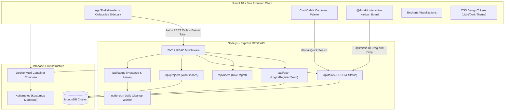

# TaskFlow — Enterprise MERN Project Management Platform

[](https://nodejs.org/)
[](https://react.dev/)
[](https://www.mongodb.com/)
[](https://vitejs.dev/)
[](https://www.docker.com/)
[](https://kubernetes.io/)

**TaskFlow** is a modern, full-stack enterprise project management platform designed for agile engineering teams. Built on the MERN stack with React 18, Vite, Node.js, Express, and MongoDB, TaskFlow delivers role-based workspaces, `@dnd-kit` drag-and-drop Kanban execution, real-time presence tracking, analytics visualization, and per-task discussion drawers.

🌐 **Live Production App**: [https://taskflow-1-7sax.onrender.com](https://taskflow-1-7sax.onrender.com)

---

## 🎨 UI & Product Screenshots

| Split-Screen Auth & Quick Demo | Interactive Kanban & Task Drawer |
| :---: | :---: |
|  |  |

| Light / Dark Theme & Command Palette | System Analytics & Member Workload |
| :---: | :---: |
|  |  |

---

## 🏗️ System Architecture



---

## ⚡ Role-Based Feature Matrix

| Feature Module | Admin Workspace | Project Manager (PM) | Team Member |
| :--- | :---: | :---: | :---: |
| **System Overview & Recharts Analytics** | 🟢 Full Access | 🟡 Project Scope | 🟡 Personal Scope |
| **User Role Management & Deletion** | 🟢 Full Access | 🔴 No Access | 🔴 No Access |
| **Create & Manage Projects** | 🟢 Full Access | 🟢 Full Access | 🟡 View Assigned |
| **Interactive @dnd-kit Kanban Board** | 🟢 Full Supervision | 🟢 Full Execution | 🟢 Drag & Move Assigned |
| **Create & Assign Tasks** | 🟢 Full Access | 🟢 Full Access | 🔴 No Access |
| **Task Drawer & Discussion Thread** | 🟢 Full Access | 🟢 Full Access | 🟢 Full Access |
| **Presence Status Picker & Idle Dot** | 🟢 Full Access | 🟢 Full Access | 🟢 Full Access |
| **Global Cmd/Ctrl+K Command Palette** | 🟢 Full Search | 🟢 Full Search | 🟢 Full Search |

---

## 🛠️ Tech Stack & Design System

- **Frontend**: React 18, Vite 5, React Router v6, `@dnd-kit` (Drag & Drop), `Recharts` (Analytics), `lucide-react` (Iconography), Axios.
- **Design System**: `tokens.css` with CSS custom properties supporting light/dark themes, `prefers-color-scheme` auto-detection, `localStorage` persistence, 4/8px spacing grid, Inter/Geist typography, 8/12/16px radii, and 150-200ms motion compliance.
- **Backend**: Node.js, Express.js, `node-cron` scheduled tasks.
- **Database**: MongoDB, Mongoose ORM.
- **Authentication**: JWT tokens stored in `localStorage`, Bcrypt password hashing.
- **Infrastructure**: Docker, Docker Compose, Kubernetes (Kustomize `bridge/`).

---

## 📁 Repository Structure

```text
TaskFlow/
├── client/                   # Frontend React 18 + Vite Application
│   ├── public/
│   ├── src/
│   │   ├── api/              # Axios API client setup (axios.js)
│   │   ├── components/
│   │   │   ├── common/       # UI Primitives (Avatar, Badge, Button, CommandPalette, Drawer, EmptyState, KanbanBoard, Skeleton, StatCard, StatusDot, StatusPicker, TaskCard, TaskModal, TaskViewModal)
│   │   │   └── layout/       # Responsive Shell (AppShell, Header, Sidebar)
│   │   ├── context/          # AuthContext, ThemeContext, ToastContext
│   │   ├── hooks/            # Custom hooks (useStatus)
│   │   ├── pages/            # Workspaces (admin/AdminDash, auth/LoginPage, pm/PMDash, pm/PMProjects, user/UserDash, user/MyProjects)
│   │   ├── styles/           # Design System (tokens.css, globals.css, components.css)
│   │   ├── App.jsx           # Role router & route guards
│   │   ├── main.jsx          # App root & context providers
│   │   └── utils.js          # Helpers (formatters, role colors, timeAgo)
│   ├── Dockerfile            # Multi-stage build (Nginx production image)
│   ├── index.html            # Vite HTML template
│   ├── package.json          # Client dependencies
│   └── vite.config.js        # Vite bundling configuration
├── server/                   # Backend Node.js + Express REST API
│   ├── middleware/           # Auth verification & RBAC authorization
│   ├── models/               # Mongoose Schemas (User, Project, Task, Comment)
│   ├── routes/               # API Routes (auth, users, projects, tasks, comments, status)
│   ├── Dockerfile            # Node.js alpine backend image
│   ├── index.js              # Express entrypoint & node-cron jobs
│   └── package.json          # Backend dependencies
├── bridge/                   # Kubernetes / Kustomize Manifests
│   ├── base/                 # Deployments, Services, Network Policies, PVC
│   └── overlays/             # Environment overlays (desktop)
├── docker-compose.yaml       # Multi-container Docker orchestration
├── package.json              # Workspace root script runner
└── README.md                 # Project documentation
```

---

## ⚙️ Environment Variables Reference

Create a `.env` file in the `server/` folder based on `.env.example`:

```env
# Server Port
PORT=5000

# Database Connection String
MONGO_URI=mongodb://localhost:27017/taskflow

# Authentication Secret
JWT_SECRET=taskflow_super_secret_jwt_key_2026

# Client URL (CORS setting)
CLIENT_URL=http://localhost:5173
```

---

## 🚀 Local Development Quickstart

1. **Clone the repository**:
   ```bash
   git clone https://github.com/Krithish04/TaskFlow.git
   cd TaskFlow
   ```

2. **Install all workspace dependencies**:
   ```bash
   npm run install:all
   ```

3. **Seed demo data**:
   Run the dev servers, open the app at `http://localhost:5173/login`, and click any **Quick Demo Login Card** (Admin, PM, or Member). It will auto-seed initial demo accounts and tasks.

4. **Start Development Servers**:
   ```bash
   npm run dev
   ```
   - **Frontend**: `http://localhost:5173`
   - **Backend REST API**: `http://localhost:5000`

---

## 🔑 Demo Account Credentials

| Role | Email | Password | Description |
| :--- | :--- | :--- | :--- |
| **Admin** | `krithish@gmail.com` | `krithish123` | System metrics, user lifecycle management, role assignments |
| **Project Manager** | `apurva@gmail.com` | `apurva123` | Sprint planning, project creation, task assignment |
| **Team Member** | `sandeep@gmail.com` | `sandeep123` | Kanban drag-and-drop, comments, personal presence |

---

## 🔧 Troubleshooting Guide

### 1. MongoDB Connection Failed (`ECONNREFUSED`)
- Ensure MongoDB is installed and running locally on port `27017` via `mongod` or Docker:
  ```bash
  docker run -d -p 27018:27017 --name mongo-dev mongo:latest
  ```

### 2. CORS Errors on Client API Calls
- Check that `CLIENT_URL` in `server/.env` matches `http://localhost:5173`.

### 3. Port Conflicts (`EADDRINUSE 5000` or `5173`)
- Kill existing node processes running on target ports:
  ```bash
  # Windows PowerShell:
  Stop-Process -Id (Get-NetTCPConnection -LocalPort 5000).OwningProcess -Force
  ```

---

## 🗺️ Roadmap & Future Scope

- [ ] **WebSockets Integration**: Socket.io real-time comment streaming & live cursor presence.
- [ ] **Custom Swimlanes**: Group Kanban board cards by epic, assignee, or priority.
- [ ] **File Attachments**: AWS S3 / Cloudinary upload integration for task attachments.
- [ ] **Slack & Email Notifications**: Webhook integration for task assignments and status updates.

---

## 📜 License

Distributed under the [MIT License](LICENSE).
